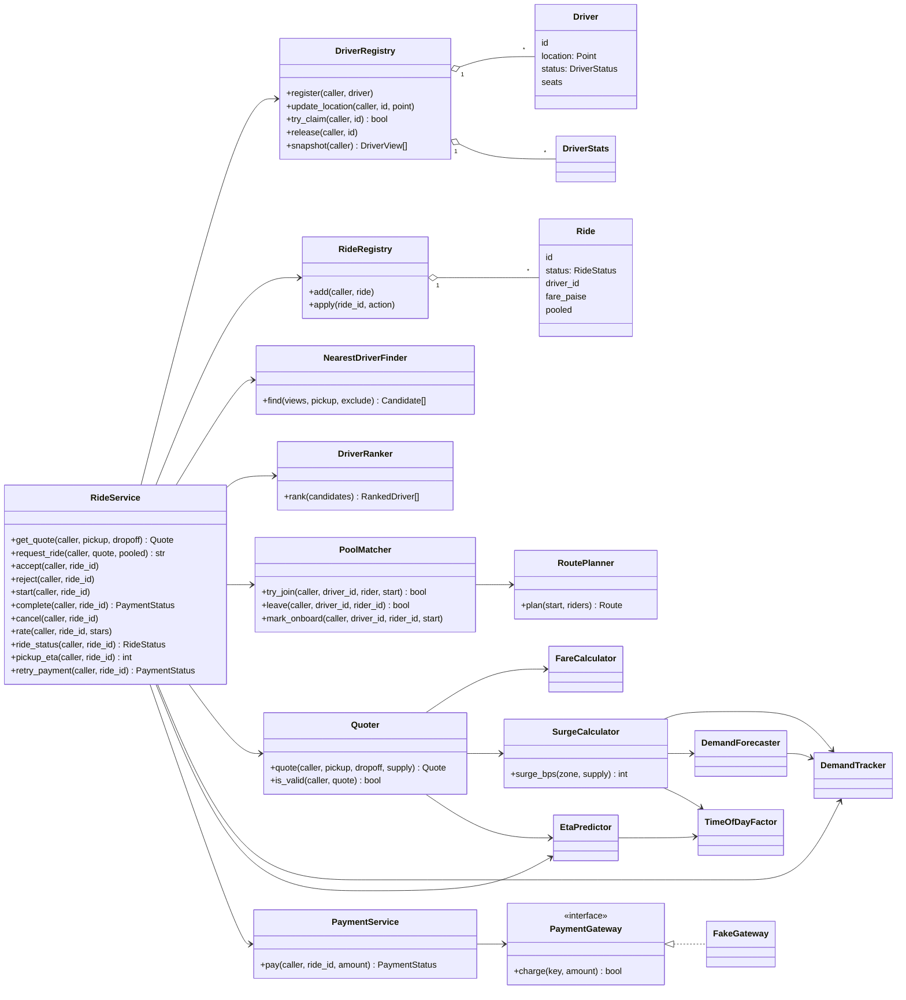
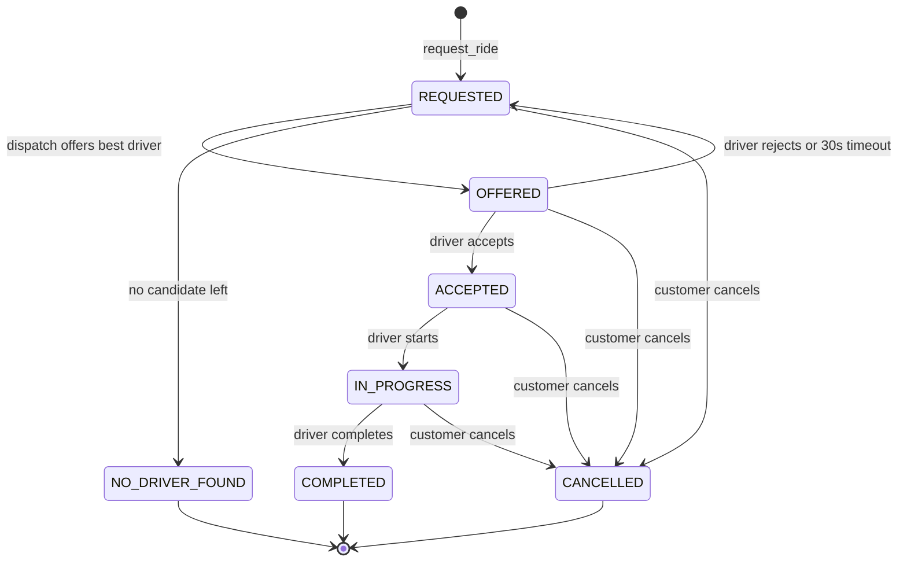
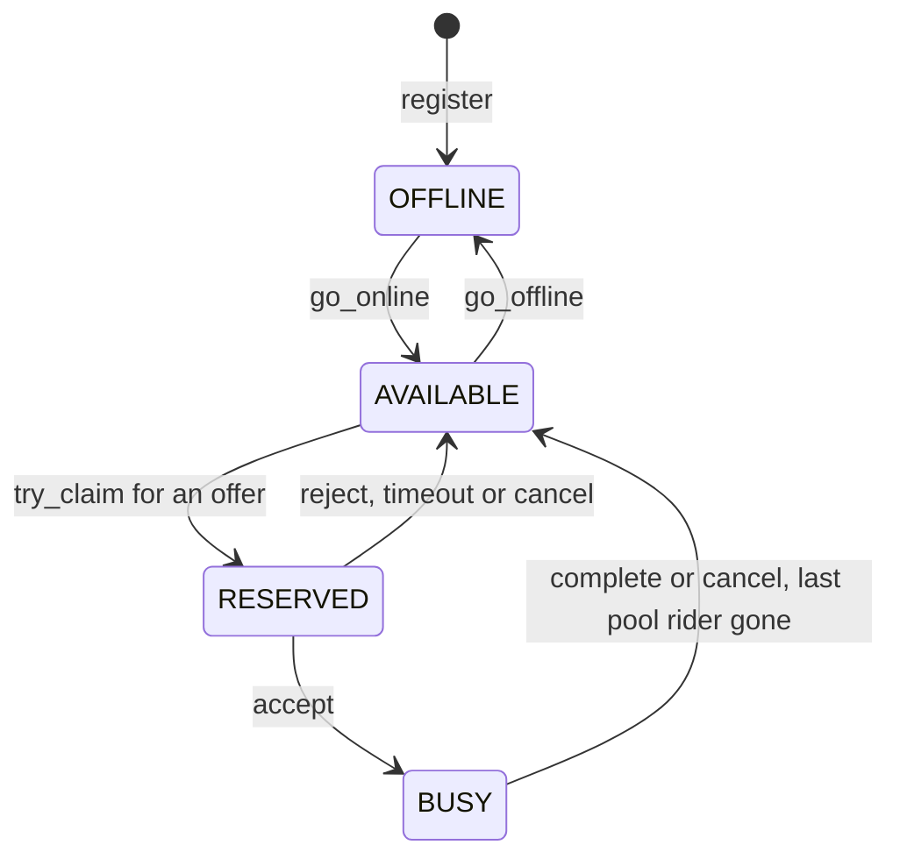
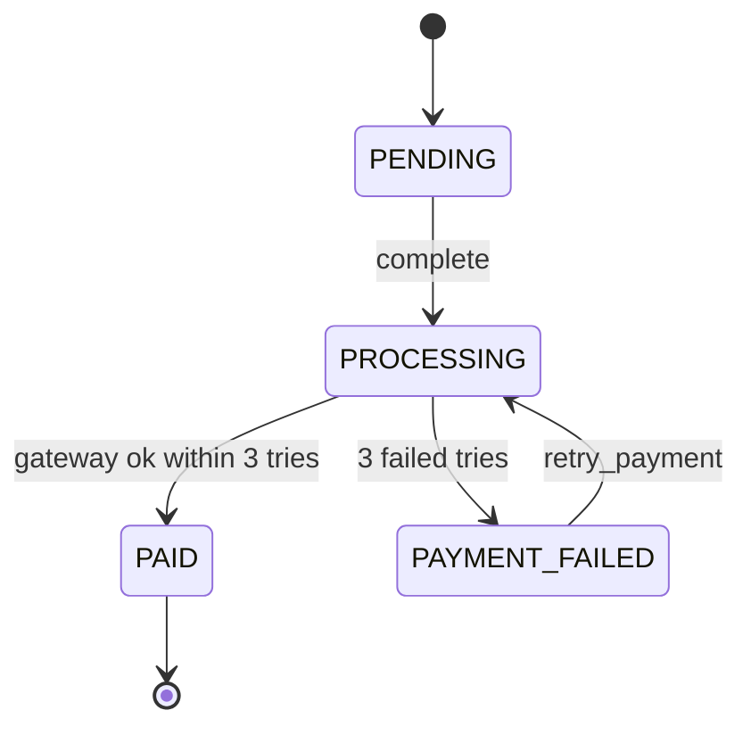
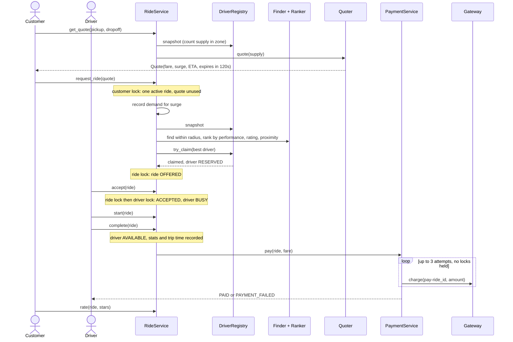
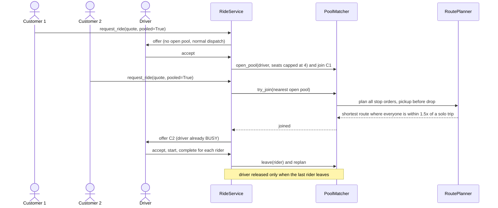

# Ride-Sharing Matching & Pricing Engine

In-memory ride-sharing engine written in pure Python (3.8+) with pytest. It uses no database and no third-party libraries.
Money is always a whole number of paise (INR). Time comes from an injectable clock, and no decision uses randomness.

## Run tests
```
python -m pytest -m "not slow" -q     # fast suite
python -m pytest -q                   # everything, incl. stress tests (marked slow)
python tools/mutate.py                # mutation check: plants 16 small bugs one at a time, tests must catch each
```

## Layout
```
engine/
  core.py       basic building blocks
  models.py     users, drivers, rides and their state rules
  registry.py   thread-safe storage of drivers and rides
  matching.py   nearest-driver search, driver ranking, pooled-ride routing
  pricing.py    fares, surge, demand forecast, ETA, quotes, pooled fare
  rides.py      booking flow and payments
tests/
  unit/         one file per module
  integration/  full booking flows across modules (world.py = shared wiring)
  stress/       many threads at once, deadlock guard (marked slow)
tools/mutate.py mutation check
PLAN.md         phase plan, decisions and known weaknesses
notes.md        original requirements and rules
```

## User flows

**Customer**
1. `get_quote(pickup, dropoff)`: returns the fare, surge, trip ETA and an expiry 120 s away. The quote is single-use.
2. `request_ride(quote, pooled=False)`: books a ride. Only one active ride is allowed per customer.
3. `ride_status(ride)`: shows where the ride stands. An offer that has gone unanswered for 30 s is passed to the next driver here.
4. `pickup_eta(ride)`: how long until the driver arrives. For a pooled ride this follows the pool route.
5. `cancel(ride)`: free at any time before completion.
6. `rate(ride, 1..5)`: once, after completion.
7. `payment_status(ride)` / `retry_payment(ride)`.

**Driver**
1. Register, go online or offline, and update location.
2. `accept(ride)` or `reject(ride)` an offer. A rejected ride goes to the next-ranked driver.
3. `start(ride)` at pickup, then `complete(ride)` at drop-off. Completing a ride triggers the payment.

## UML diagrams

### Component / class diagram


### Ride state machine


### Driver state machine


### Payment state machine


### Sequence: quote, book, ride, pay (solo)


### Sequence: pooled ride


## Modules

### `core.py`: building blocks
- `Clock` / `FixedClock`: the current time in whole seconds. Tests advance it by hand, and it never goes backwards.
- `Point` and `manhattan()`: integer grid cells. Distance is `|dx| + |dy|`. Printing a point hides its coordinates.
- Errors: `ValidationError`, `NotAllowedError`, `InvalidTransitionError`, `NotFoundError` and `ExpiredError`. Each one carries only a fixed message, so user data never leaks into an error.
- `IdGenerator`: thread-safe sequential ids such as `ride-1`.

### `models.py`: who and what
- `Role` (CUSTOMER, DRIVER, SYSTEM) and `Caller`: every operation receives a caller. `require()` rejects the wrong role or the wrong user.
- `Customer`: only the customer themself can read their name.
- `Driver`: location, seat count and status.
  - Status moves: `OFFLINE → AVAILABLE → RESERVED → BUSY → AVAILABLE`.
  - The driver switches themself online or offline. Going offline is blocked while they are reserved or busy.
  - The system reserves, marks busy and releases drivers.
- `DriverStats`: accepts, rejects, completions, ratings (1–5) and predicted vs actual trip seconds.
- `Ride`: a state machine.
  ```
  REQUESTED → OFFERED → ACCEPTED → IN_PROGRESS → COMPLETED
  OFFERED → REQUESTED              (driver rejected or offer expired; driver excluded)
  REQUESTED → NO_DRIVER_FOUND
  any non-final state → CANCELLED  (customer, always free)
  ```
  Each move checks the caller:
  - only the system offers a ride;
  - only the offered driver accepts or rejects;
  - only the assigned driver starts or completes;
  - only the ride's own customer cancels or rates, and rates just once after completion.

### `registry.py`: thread-safe storage
- `DriverRegistry`: each driver has their own lock. A small index lock guards only the dictionary lookup.
  - `try_claim` reserves an AVAILABLE driver in one locked step. If another ride got the driver first, it returns False.
  - `snapshot` and `view` return read-only `DriverView` copies.
- `RideRegistry`: each ride has its own lock. `apply(ride_id, fn)` runs `fn` while holding only that ride's lock.

### `matching.py`: who drives, and in what order
- `NearestDriverFinder`: this is the basic matching. It keeps AVAILABLE drivers within the radius and sorts them nearest first, breaking ties by id.
- `DriverRanker`: the recommendation. Every candidate gets a score from 0 to 10000:
  - **40% past performance**: the average of acceptance rate and completion rate.
  - **30% rating**: 1★ scores 0 and 5★ scores 100.
  - **30% proximity**: 100 at the pickup, falling to 0 at the edge of the radius.

  New drivers score a neutral 50 on performance and rating. Ties go to the nearer driver, then the lower id.
- `RoutePlanner`: shared-ride routing.
  - It tries every stop order where each pickup comes before its drop (at most 4 riders).
  - It drops any order that breaks the detour rule.
  - It picks the shortest remaining order.
- `PoolMatcher`: one pool per driver, each with its own lock.
  - Seats are capped at 4.
  - A rider joins only if a seat is free and a valid route exists.
  - Removing a rider replans the route.

**Detour rule:** a rider's time from now until their drop-off, waiting plus riding, must be at most 1.5× what it would take if the driver served them alone (driver → their pickup → their drop). Serving riders one after another makes the later rider wait too long, so a far-off rider is refused.

### `pricing.py`: price and time
- `FareCalculator`: ₹30 base + ₹12 per cell, minimum ₹50. Surge is applied and the result rounded down to whole paise.
- `ZoneMap`: splits the grid into 10×10 zones and counts the AVAILABLE drivers (supply) in a zone.
- `DemandTracker`: counts requests per zone in 5-minute windows, with one lock per zone. It keeps the last 3 windows.
- `DemandForecaster`: predicted demand is the average of the last 3 finished windows.
- `TimeOfDayFactor`: 1.5× at 08:00–10:00 and 17:00–20:00. The start time counts; the end time does not.
- `SurgeCalculator`: blends 50% live demand-to-supply, 20% time of day and 30% forecast-to-supply. The result is in basis points and kept between 1.0× (10000) and 3.0× (30000).
- `EtaPredictor`: seconds = cells × 60 × traffic × driver speed factor, rounded up.
- `driver_factor_bps`: a driver's actual trip time divided by the predicted time, kept between 0.5× and 2.0×. A driver with no trips gets 1.0×.
- `Quote` / `Quoter`: holds a unique id, the fare, surge, ETA, pickup and dropoff. It is valid for 120 s, only for the customer who asked for it, and books at most one ride.
- `pooled_fare`: the rider's solo fare minus 25%.

### `rides.py`: booking flow and payments
- `RideService`: runs the booking flow.
  - `get_quote`: the engine counts driver supply itself, so a customer can't influence surge.
  - `request_ride(quote, pooled=False)`: needs a valid quote, and the customer can have only one active ride. The request counts toward surge demand, then the ride is dispatched.
  - Dispatch: find candidates, rank them, `try_claim` the best free driver and offer them the ride. If no candidate is left, the ride becomes `NO_DRIVER_FOUND`.
  - Pooled rides:
    - A pooled ride first tries to join the nearest open pool within the radius (seat free and detour rule met), and is offered to that pool's driver.
    - Otherwise it is dispatched like a solo ride, and the driver's pool opens when they accept.
    - The fare is 25% off.
    - The driver stays BUSY until the last pooled rider is dropped or cancels.
    - Pickup ETA follows the pool route.
    - Pooled trips are not used for the driver speed factor.
  - `accept` / `reject`: a reject sends the ride to the next-ranked driver. An offer more than 30 s old expires when the driver tries to accept or the customer checks the status, and counts as a reject.
  - `start`: records a baseline trip-time prediction.
  - `complete`: frees the driver, updates their stats and trip time, then charges the fare.
  - `cancel` (free, and releases the driver), `rate`, `pickup_eta`, `payment_status` and `retry_payment`.
- `PaymentService`: up to 3 attempts, then `PAYMENT_FAILED`.
  - Every charge for a ride uses the same key (`pay-<ride_id>`), so a retry never charges twice.
  - A concurrent call sees `PROCESSING` and does nothing.
  - The gateway is called outside all locks, and its error details are never exposed.
- `PaymentGateway` protocol and `FakeGateway`: a scripted gateway that returns success, failure, "lost reply" (money taken but no reply) or an exception.

## Concurrency rules
- Every shared item has its own lock: each driver, ride, customer, demand zone, pool and payment. There is never one global lock.
- **Lock order:** the ride lock is always taken first, then the driver or customer lock. Nothing takes a driver lock and then a ride lock, so the two can't deadlock.
- **Lock order with pools:** ride lock first, then pool lock, then driver lock. A pool never takes a ride or driver lock.
- No lock is held during slow work such as payment gateway calls.

## Security and privacy
- Every public operation checks the caller's role and identity.
- Printed objects (`repr`) hide names, locations and customer/driver ids on rides.
- Error messages are fixed text.


## Known gaps
- Traffic depends on time of day only, not on zone.
- An expired offer is only noticed when someone acts on the ride; there is no background timer.
- Customers and drivers are identified by caller id only. `Customer` objects are not registered with the service.
- Pools are only joined before the driver moves on; the pool route start is updated at join and at pickup.
